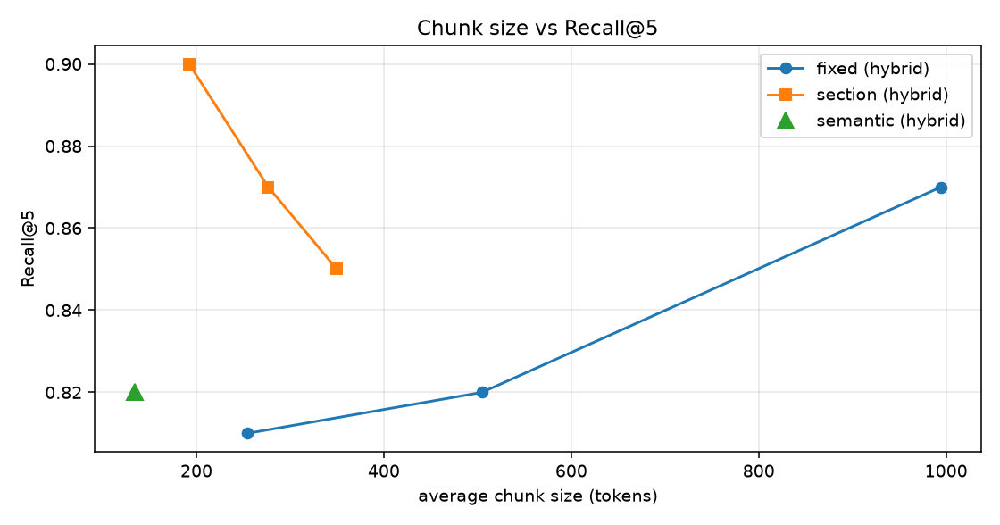

# Experimental results

_All numbers are measured by the scripts in `src/scholaragent/evaluation/` on the benchmark described in the README (LLM-generated questions with chunking-independent evidence spans; see 'Limitations of this evaluation')._

## 1. Retrieval architectures (test split)

| System | Recall@1 | Recall@3 | Recall@5 (95% CI) | Recall@10 | MRR | NDCG@5 | Precision@5 | latency ms |
|---|---|---|---|---|---|---|---|---|
| Dense (vector) | 0.490 | 0.680 | 0.740 [0.65, 0.82] | 0.780 | 0.597 | 0.541 | 0.160 | 7.7 |
| BM25 | 0.620 | 0.750 | 0.820 [0.74, 0.89] | 0.870 | 0.695 | 0.607 | 0.180 | 0.2 |
| Hybrid (RRF) | 0.620 | 0.750 | 0.790 [0.71, 0.87] | 0.900 | 0.700 | 0.617 | 0.176 | 7.9 |
| Hybrid (RSF) | 0.680 | 0.800 | 0.870 [0.8, 0.93] | 0.900 | 0.752 | 0.664 | 0.194 | 7.6 |
| Hybrid (RRF) + Reranker | 0.820 | 0.890 | 0.930 [0.88, 0.97] | 0.950 | 0.866 | 0.749 | 0.204 | 256.6 |
| Hybrid (RSF) + Reranker | 0.810 | 0.880 | 0.920 [0.86, 0.97] | 0.940 | 0.855 | 0.739 | 0.202 | 259.0 |
| Hybrid (RSF) + fine-tuned Reranker [final system] | 0.870 | 0.930 | 0.930 [0.87, 0.98] | 0.940 | 0.900 | 0.768 | 0.208 | 259.2 |

Recall@5 by question type:

| System | comparison | factual | limitations | mathematical | methodological | results |
|---|---|---|---|---|---|---|
| Dense (vector) | 0.533 | 0.750 | 0.800 | 0.750 | 0.800 | 0.800 |
| BM25 | 0.667 | 0.800 | 0.800 | 0.850 | 0.950 | 0.800 |
| Hybrid (RRF) | 0.600 | 0.800 | 0.700 | 0.800 | 0.900 | 0.867 |
| Hybrid (RSF) | 0.733 | 0.900 | 0.700 | 0.900 | 1.000 | 0.867 |
| Hybrid (RRF) + Reranker | 0.733 | 0.950 | 1.000 | 0.950 | 1.000 | 0.933 |
| Hybrid (RSF) + Reranker | 0.733 | 0.950 | 1.000 | 0.950 | 1.000 | 0.867 |
| Hybrid (RSF) + fine-tuned Reranker [final system] | 0.800 | 0.950 | 1.000 | 0.950 | 1.000 | 0.867 |

## 2. Chunking strategies (test split)

| Strategy | #chunks | avg tokens | Dense R@5 | Hybrid R@5 | Hybrid MRR | Hybrid+Rerank R@5 | Hybrid+Rerank MRR |
|---|---|---|---|---|---|---|---|
| fixed-256 | 1971 | 254.3 | 0.660 | 0.810 | 0.647 | 0.880 | 0.814 |
| fixed-512 | 993 | 504.8 | 0.640 | 0.820 | 0.617 | 0.890 | 0.814 |
| fixed-1024 | 488 | 994.4 | 0.540 | 0.870 | 0.659 | 0.690 | 0.556 |
| section-256 | 2359 | 192.1 | 0.760 | 0.900 | 0.751 | 0.940 | 0.884 |
| section-384 | 1639 | 276.6 | 0.740 | 0.870 | 0.752 | 0.920 | 0.855 |
| section-512 | 1291 | 349.8 | 0.670 | 0.850 | 0.740 | 0.930 | 0.845 |
| semantic-384 | 3292 | 134.2 | 0.690 | 0.820 | 0.694 | 0.870 | 0.805 |



## 3. Rerankers (test split)

| Reranker | Recall@1 | Recall@5 | MRR | NDCG@5 | latency ms/query |
|---|---|---|---|---|---|
| none (hybrid, RSF fusion) | 0.680 | 0.870 | 0.752 | 0.664 | 7.7 |
| BAAI/bge-reranker-v2-m3 | 0.810 | 0.920 | 0.855 | 0.739 | 259.5 |
| BAAI/bge-reranker-base | 0.760 | 0.950 | 0.842 | 0.736 | 89.1 |
| cross-encoder/ms-marco-MiniLM-L-6-v2 | 0.680 | 0.880 | 0.767 | 0.678 | 26.5 |
| models/scholar-rerank | 0.870 | 0.930 | 0.900 | 0.768 | 258.8 |

## 4. Embedding models (test split)

| Model | Dense R@5 | Dense MRR | Hybrid R@5 | Hybrid MRR | Hybrid+Rerank R@5 | Hybrid+Rerank MRR |
|---|---|---|---|---|---|---|
| sentence-transformers/all-MiniLM-L6-v2 | 0.580 | 0.437 | 0.830 | 0.705 | 0.920 | 0.846 |
| BAAI/bge-small-en-v1.5 | 0.570 | 0.460 | 0.840 | 0.714 | 0.920 | 0.857 |
| BAAI/bge-base-en-v1.5 | 0.620 | 0.529 | 0.830 | 0.712 | 0.920 | 0.855 |
| BAAI/bge-large-en-v1.5 | 0.710 | 0.585 | 0.860 | 0.720 | 0.890 | 0.838 |
| BAAI/bge-m3 | 0.740 | 0.597 | 0.870 | 0.752 | 0.920 | 0.855 |
| intfloat/e5-base-v2 | 0.690 | 0.576 | 0.830 | 0.737 | 0.930 | 0.851 |
| models/scholar-embed | 0.770 | 0.618 | 0.850 | 0.729 | 0.910 | 0.854 |
| models/scholar-embed-m3 | 0.790 | 0.686 | 0.850 | 0.749 | 0.930 | 0.866 |

## 5. Ablation (test split)

| Configuration | Recall@1 | Recall@5 | MRR | NDCG@5 |
|---|---|---|---|---|
| Full system (section chunks + contextual header + hybrid + rerank) | 0.810 | 0.920 | 0.855 | 0.739 |
| - BM25 (dense + rerank) | 0.750 | 0.840 | 0.788 | 0.681 |
| - dense retriever (BM25 + rerank) | 0.800 | 0.910 | 0.845 | 0.725 |
| - reranker (hybrid only) | 0.680 | 0.870 | 0.752 | 0.664 |
| - section-aware chunking (fixed 384 tokens) | 0.740 | 0.930 | 0.819 | 0.750 |
| - contextual header (embed raw chunk text) | 0.800 | 0.900 | 0.843 | 0.725 |

## 6. Answer quality of the end-to-end systems (test split, n=100)

_Faithfulness (LLM) / hallucination rate / citation metrics: claims are extracted from the final answer and judged by an LLM judge with its own rubric. Faithfulness (NLI): the same claims judged by the fine-tuned NLI model (independent architecture; for systems G-J, which use that NLI model inside the verifier, this column is NOT independent)._

| System | Correctness | Strict correct | Abstain | Faithfulness (LLM) | Faithfulness (NLI) | Citation accuracy | Citation completeness | Hallucination rate (LLM) | Claims removed | s/question | LLM calls/q |
|---|---|---|---|---|---|---|---|---|---|---|---|
| A Dense | 0.505 | 0.450 | 0.290 | 0.569 | 0.777 | 0.704 | 0.835 | 0.431 | 0 | 3.35 | 9.4 |
| B BM25 | 0.605 | 0.550 | 0.210 | 0.647 | 0.766 | 0.698 | 0.810 | 0.353 | 0 | 1.59 | 9.7 |
| C Hybrid | 0.565 | 0.510 | 0.250 | 0.628 | 0.763 | 0.743 | 0.777 | 0.372 | 0 | 1.76 | 9.1 |
| D Hybrid+Rerank | 0.630 | 0.580 | 0.140 | 0.614 | 0.781 | 0.690 | 0.869 | 0.386 | 0 | 2.02 | 10.7 |
| E D+Verification | 0.615 | 0.560 | 0.150 | 0.630 | 0.780 | 0.696 | 0.852 | 0.370 | 42 | 12.59 | 18.1 |
| F E+QueryRewrite (full) | 0.605 | 0.550 | 0.210 | 0.651 | 0.798 | 0.664 | 0.861 | 0.349 | 39 | 13.54 | 17.6 |
| G D+NLI-first verification | 0.605 | 0.530 | 0.150 | 0.633 | 0.867 | 0.664 | 0.883 | 0.367 | 52 | 9.03 | 13.5 |
| H G+QueryRewrite | 0.575 | 0.500 | 0.200 | 0.643 | 0.874 | 0.650 | 0.899 | 0.357 | 47 | 10.41 | 13.8 |
| I D+decomposition+reflective answering | 0.595 | 0.560 | 0.120 | 0.610 | 0.810 | 0.694 | 0.835 | 0.390 | 0 | 2.7 | 11.9 |
| J I+NLI-first verification | 0.580 | 0.510 | 0.130 | 0.597 | 0.884 | 0.679 | 0.871 | 0.403 | 51 | 9.69 | 14.7 |

Correctness by question type:

| System | comparison | factual | limitations | mathematical | methodological | results |
|---|---|---|---|---|---|---|
| A Dense | 0.167 | 0.550 | 0.650 | 0.550 | 0.550 | 0.567 |
| B BM25 | 0.233 | 0.700 | 0.600 | 0.650 | 0.725 | 0.633 |
| C Hybrid | 0.200 | 0.700 | 0.500 | 0.575 | 0.625 | 0.700 |
| D Hybrid+Rerank | 0.233 | 0.775 | 0.600 | 0.675 | 0.725 | 0.667 |
| E D+Verification | 0.167 | 0.775 | 0.550 | 0.675 | 0.675 | 0.733 |
| F E+QueryRewrite (full) | 0.233 | 0.775 | 0.450 | 0.600 | 0.725 | 0.700 |
| G D+NLI-first verification | 0.267 | 0.725 | 0.550 | 0.650 | 0.675 | 0.667 |
| H G+QueryRewrite | 0.167 | 0.725 | 0.450 | 0.675 | 0.700 | 0.567 |
| I D+decomposition+reflective answering | 0.067 | 0.675 | 0.600 | 0.675 | 0.750 | 0.700 |
| J I+NLI-first verification | 0.233 | 0.650 | 0.550 | 0.650 | 0.675 | 0.633 |

## 7. Claim verifiers

Held-out claims generated from the 40 test papers (628 claims, 4 balanced classes):

| Verifier | Accuracy | Macro-F1 | Bad-claim detection rate | False-alarm rate |
|---|---|---|---|---|
| llm_judge | 0.674 | 0.648 | 0.845 | 0.108 |
| nli_finetuned | 0.931 | 0.932 | 0.970 | 0.064 |
| ensemble | 0.678 | 0.656 | 0.860 | 0.127 |

Human-annotated SciFact validation (340 claims, 3-way; the NLI model was fine-tuned on SciFact-train):

| Verifier | Accuracy | Macro-F1 |
|---|---|---|
| llm_judge | 0.694 | 0.602 |
| nli_finetuned | 0.821 | 0.811 |

## 8. Error analysis (test split)

Retrieval (does the top-5 contain all evidence?):

| Outcome | count | % |
|---|---|---|
| ok (all evidence in top-5) | 86 | 86.0 |
| retrieval failure - wrong paper retrieved | 7 | 7.0 |
| ranking failure (candidate found, ranked below top-5) | 6 | 6.0 |
| parsing/chunking loss (evidence text not in any chunk) | 1 | 1.0 |

Answers of system *G D+NLI-first verification* (correctness < 1 attributed to one cause, in priority order):

| Outcome | count | % |
|---|---|---|
| correct | 53 | 53.0 |
| hallucinated claim | 22 | 22.0 |
| over-cautious abstention | 12 | 12.0 |
| retrieval failure (evidence not in context) | 5 | 5.0 |
| generation failure (incomplete / misread evidence) | 4 | 4.0 |
| incorrect citation | 4 | 4.0 |

## 9. Agent evaluation

| metric | value |
|---|---|
| tasks | 7 |
| task_completion_rate | 1.0 |
| failure_rate | 0.0 |
| avg_steps | 3.4 |
| avg_tool_selection_accuracy | 1.0 |
| avg_required_actions_covered | 1.0 |
| unnecessary_calls_total | 0 |
| avg_latency_s | 91.3 |
| total_tokens | 222906 |
| cost_usd | 0.0 |

| task | mode | status | intent | steps | tool-sel acc | required covered | unnecessary | claims checked | latency s | tokens |
|---|---|---|---|---|---|---|---|---|---|---|
| survey_deep | deep | ok | survey | 7 | 1.0 | 1.0 | 0 | 36 | 187.6 | 34249 |
| compare_deep | deep | ok | comparison | 5 | 1.0 | 1.0 | 0 | 14 | 129.9 | 48475 |
| qa_deep | deep | ok | qa | 3 | 1.0 | 1.0 | 0 | 0 | 41.4 | 13897 |
| qa_mypapers | my_papers | ok | qa | 1 | 1.0 | 1.0 | 0 | 7 | 28.9 | 9033 |
| compare_mypapers | my_papers | ok | comparison | 3 | 1.0 | 1.0 | 0 | 7 | 106.8 | 80076 |
| gaps_mypapers | my_papers | ok | gaps | 5 | 1.0 | 1.0 | 0 | 36 | 144.3 | 37176 |
| nonsense_query | deep | ok | comparison | 0 | 1.0 | 1.0 | 0 | None | 0.0 | 0 |

## 10. Fine-tuning

```json
{
 "scholar-embed": {
  "base": "BAAI/bge-base-en-v1.5",
  "train_pairs": 4445,
  "epochs": 3.0,
  "dev_metrics": {
   "dev_cosine_accuracy@1": 0.5575221238938053,
   "dev_cosine_accuracy@5": 0.7787610619469026,
   "dev_cosine_accuracy@10": 0.8761061946902655,
   "dev_cosine_precision@5": 0.16991150442477876,
   "dev_cosine_recall@5": 0.7345132743362832,
   "dev_cosine_ndcg@10": 0.6872905747335013,
   "dev_cosine_mrr@10": 0.6574589127686473,
   "dev_cosine_map@100": 0.6435765068633903
  }
 },
 "scholar-rerank": {
  "base": "BAAI/bge-reranker-v2-m3",
  "examples": 17656,
  "epochs": 1.0,
  "baseline_dev": {
   "dev_map": 0.8670429653888301,
   "dev_mrr@10": 0.8641496598639455,
   "dev_ndcg@10": 0.8882100706963959
  },
  "dev_metrics": {
   "dev_map": 0.8910774410774411,
   "dev_mrr@10": 0.8892290249433107,
   "dev_ndcg@10": 0.9089533941010051
  }
 }
}
```
